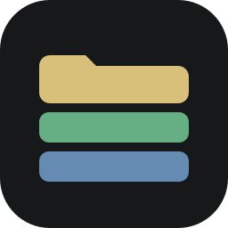
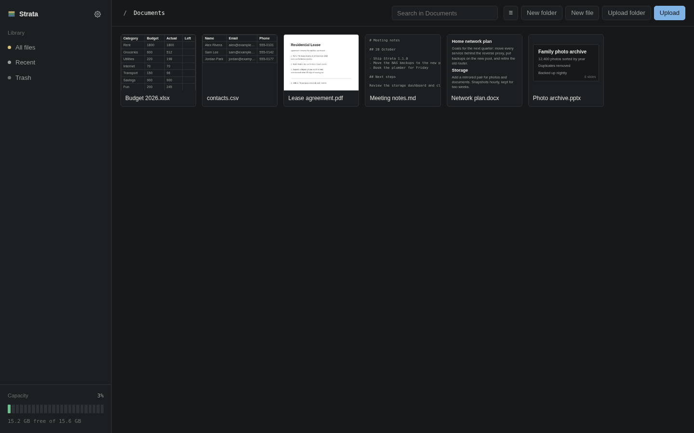
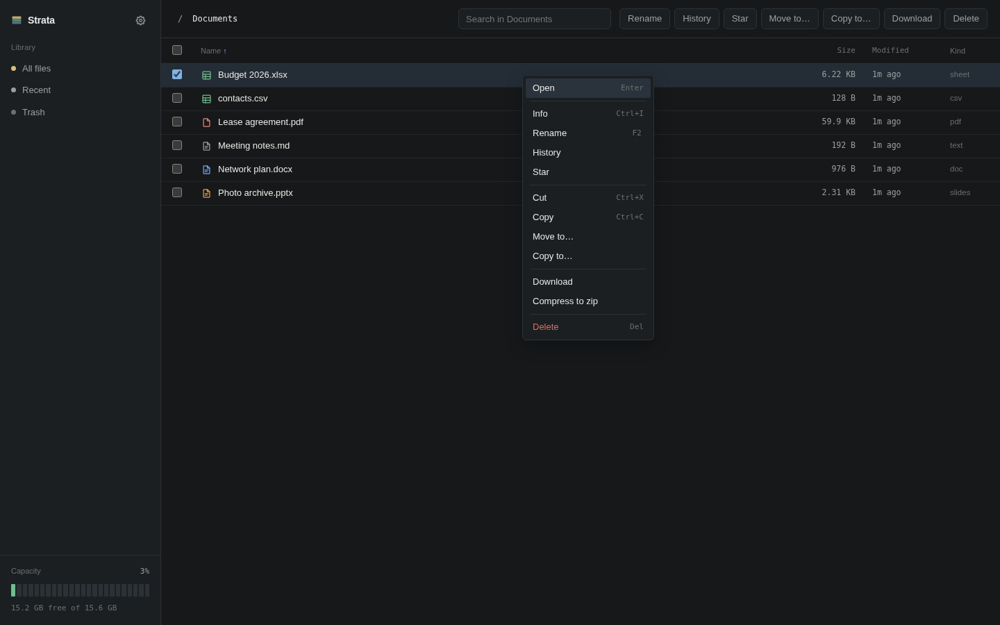
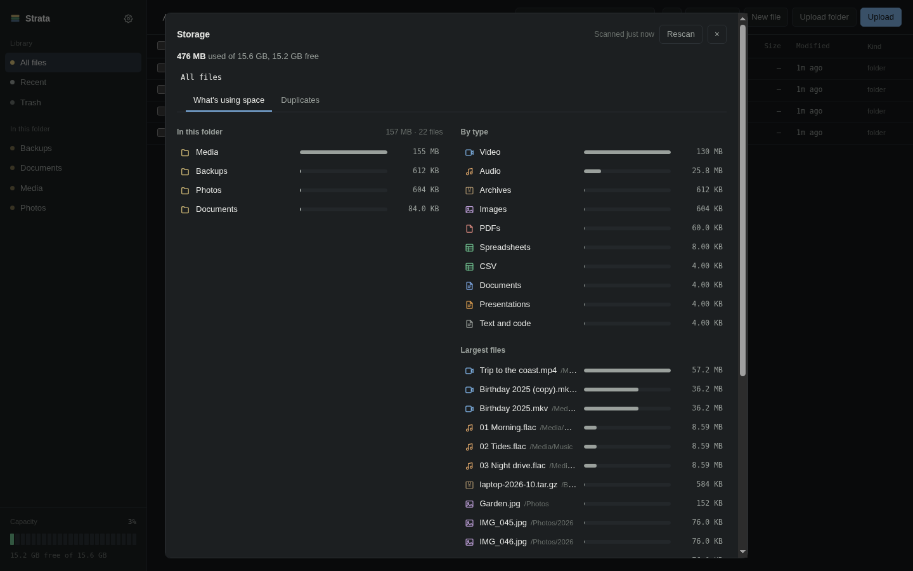
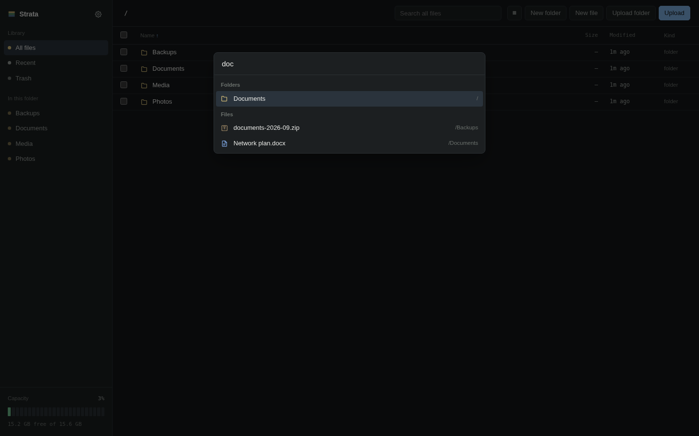

<div align="center">



# Strata

### A file manager for your TrueNAS share

**Browse, upload, preview and edit the files on your NAS from any browser, with a trash and version history behind every change.**

[](https://github.com/ah410/strata/actions/workflows/ci.yml)
[](https://github.com/ah410/strata/releases/latest)
[](LICENSE)
[](#install)
[](#development)
[](https://www.anthropic.com/claude-code)
[](SECURITY.md)

[Install](#install) · [Features](#features) · [Using it](#using-it) · [Security](#how-it-protects-your-files) · [Configuration](#configuration) · [Development](#development)

</div>

<br />

<p align="center">
  
  
  
  
</p>

Strata is a self-hosted file manager for a TrueNAS dataset. It's one Go binary with the UI
embedded, shipped as a distroless image of about 20 MB. There's no database: your files stay
where they are on the dataset, and the little Strata remembers (the passphrase hash, a TLS
certificate, favorites, a thumbnail cache) lives in one config directory. It makes no network
connections of its own and has no analytics.

I wanted Nextcloud's convenience for my own NAS without running Nextcloud, so I built Strata with
Claude in Claude Code, directing the work and testing it against my own TrueNAS server.

Strata is an independent project. It is not affiliated with, endorsed by or sponsored by TrueNAS
or iXsystems. TrueNAS® is a registered trademark of iXsystems, Inc., used here only to say what
Strata works with.

## Install

### TrueNAS SCALE

Strata is [submitted to the TrueNAS community catalog](https://github.com/truenas/apps/pull/6142)
and pending review. Once it's listed, install **Strata** from Apps, pick the dataset to browse,
and give the app's user (568 `apps` by default) a **Modify** ACL entry on it. When it's running,
open the app's logs, copy the setup code, and open the Web UI to choose a passphrase. Until then,
use the compose file below.

### Docker Compose (or a Dockge stack)

Copy [docker-compose.yml](docker-compose.yml), set the dataset path and a `user:` that can write
to it, and run `docker compose up -d`. Then:

```bash
docker logs strata 2>&1 | grep "SETUP CODE"
```

Open `https://<your-nas>:8443`, accept the self-signed certificate (the logs print its
fingerprint so you can check it), enter the code, and choose a passphrase.

Images are published as `ghcr.io/ah410/strata` for amd64 and arm64, signed with cosign. Pin a
version (`:1.1.0`) or a digest in production.

## Features

Strata covers the everyday work of a file manager: browse, search names below any folder, upload
files or whole folders, and rename, move or copy with a folder picker, by dragging, or with cut
and paste. Uploads show live progress with speed and time left, resume after a dropped
connection, and stay under a reverse proxy's size limit on their own. You can download a
selection as a zip, compress it to a zip on the share, or extract a `.zip` or `.tar.gz` into a
new folder.

Images, PDF, video and audio open in the browser. The grid view shows image thumbnails, and can
also show the first page of PDFs, Word, Excel, PowerPoint and text files. Workbooks open in a
spreadsheet editor that recalculates on the server and keeps formulas intact, and text files open
in an editor with Markdown preview. Both refuse to overwrite a file that changed since you
opened it.

Everything has a right-click menu and a keyboard shortcut, and Ctrl+K jumps to any file or runs
any action. Clicking the capacity meter shows which folders and files fill the pool and finds
duplicate files. There are favorites, recent files, light and dark themes chosen per file type,
and an optional WebDAV mount so the share works as a network drive.

Nothing you do in the browser is final. Deleting goes to a trash with Undo, and every file Strata
replaces keeps its previous versions.

## Using it

Click a folder to open it and a file to preview or edit it. Drop files or folders anywhere on the
listing to upload them, or paste files and screenshots. Click a row to select it, Shift-click to
select a range, Ctrl-click (Cmd on a Mac) to add one, or drag a box across empty space. Dragging
rows onto a folder or a breadcrumb moves them (hold Ctrl or Alt to copy). The search box looks at
names below the folder you're in, and the button next to it switches between list and grid.

Right-click anything for its actions, or empty space for the folder's. Hold Shift while
right-clicking to get the browser's own menu instead. Every action has a keyboard shortcut; press
`?` or Ctrl+/ (Cmd+/), or open **Settings**, to see them all. Ctrl+K (Cmd+K) opens a palette that runs any action or
jumps to any file by name.

### Uploads

A large upload shows how much has gone up out of the total, how many files are done, the speed
and the time left, and files appear in the folder as they finish. Cancel keeps the files that
already arrived. Big files go up in 8 MB pieces and pick up where they left off after a dropped
connection or a page reload; small files are sent in bundles of about 8 MB. If a reverse proxy
refuses a request as too large, Strata sends smaller pieces instead, so uploads never fail on a
proxy's body limit. A single file can be as large as the free space on the dataset.

### Archives

**Extract here** unpacks a `.zip`, `.tar`, `.tar.gz` or `.tgz` into a new folder named after it,
so nothing existing is ever overwritten. **Compress to zip** saves a selection as a zip beside
it. Both run in the background and show progress at the top.

### Storage

Click the capacity meter in the sidebar for a breakdown of what fills the share: folders and
files by size (click a folder to drill in), the largest files, a split by file type, and how much
the trash and version history hold. Adding up a large share takes a few minutes the first time;
after that it reads from the last scan and refreshes every 15 minutes or on **Rescan**. The
**Duplicates** tab compares file contents below a folder and moves the extra copies you tick to
the trash.

### Document previews

In **Settings**, **Show document previews in grid view** makes grid cards show the first page of
PDFs, Word, Excel, PowerPoint, Markdown, CSV and text files instead of an icon. It's off by
default and saved per browser. PDFs render in the browser, and the code for that only downloads
when the setting is on.

### Workbooks and text

Click any `.xlsx` to open the editor. Click a cell to select it, type to replace, and press Enter
to commit. The formula bar shows the real formula rather than the computed value. A cell with a
small triangle in its corner holds a formula, and typing into it replaces that formula with a
literal, so do it deliberately. Edits recalculate on the server, so everything downstream updates
the way it would in Excel.

Text, CSV and Markdown files open in an editor; Ctrl+S saves. Markdown opens in a rendered
preview first. Relative images in Markdown load from the share, and remote images are blocked.

### Editing here and over SMB

Strata won't overwrite someone else's save. Each save is checked against the version the editor
loaded; if the file changed since (Excel over SMB, another tab), the save is refused and your
edits stay on screen. Saves are atomic, so a crash mid-save never leaves a half-written file.

Excel has no such check, though: if Strata saves while the workbook is open in Excel, Excel's
next save wins. Use one or the other for a given editing session. Strata is the convenient path
from a phone or a borrowed laptop, and SMB plus real Excel is better for heavy work.

### Trash and version history

Deleting moves things to the **Trash** in the sidebar, and the toast offers **Undo**. Items stay
restorable for 30 days (`STRATA_TRASH_DAYS`), then they're removed for good. Restoring never
overwrites: if the old name is taken, the item comes back as `name (restored).ext`.

Every time Strata replaces a file (saving a workbook or text file, uploading over an existing
file, restoring an old version), the previous copy is kept. **History** lists the last 20 copies
from up to 90 days back, with Download and Restore. Restoring is itself kept as a version, so it
can be undone too.

Both live in a `.strata` folder at the top of each dataset, so moving something into them is an
instant rename rather than a copy. SMB users will see that folder; leave it alone, or delete it to
discard all trash and history for that dataset. Partial uploads wait in the same folder and are
cleaned up after a day. None of this replaces ZFS snapshots, which also cover changes made outside
Strata.

### Mounting it as a drive (WebDAV)

Set `STRATA_WEBDAV=on` and the share is also served over WebDAV at `/dav/`. Connect to
`https://<your-nas>:8443/dav/` from Finder (Go, Connect to Server), Windows (Map network drive), a
Linux file manager (`davs://`), or a phone app. Any user name works; the password is your Strata
passphrase.

It follows the same rules as the web UI: deleting moves items to the trash, overwriting keeps the
previous version, an upload that breaks off halfway leaves the old file alone, and the `.strata`
folder doesn't appear. It's off by default because it's another way in.

## How it protects your files

Strata asks for a passphrase before showing anything. There are no user accounts: one
passphrase, hashed with argon2id, unlocks it. Five wrong guesses lock a client out with growing
delays (up to 15 minutes), and a global cap stops rotating addresses from helping. Sessions live
in memory, so restarting the container signs everyone out.

Every file access goes through Go's `os.Root`, so no request path or symlink can leave the served
directory, and Strata's own `.strata` folder is unreachable from the API. Uploaded files are
served with a sandboxing Content-Security-Policy, and anything a browser would execute is served
as plain text. State-changing requests need a custom header and a same-origin fetch, and the
`Host` header is checked against an allowlist to stop DNS rebinding. Archives, images and
documents are treated as hostile: extraction refuses paths that climb out of the target folder,
skips links and counts inflated bytes against the free space, and previews read through fixed
caps on size and decompression.

The image is distroless, runs as non-root, and works with a read-only root filesystem and all
capabilities dropped. CI runs CodeQL, govulncheck, gitleaks and Snyk on every change, and every
third-party action is pinned to a commit. See [SECURITY.md](SECURITY.md) for the details and to
report a vulnerability.

### First run and the passphrase

With a config volume at `/config`, Strata prints a one-time setup code in its logs on every start
until setup is done:

```
FIRST-RUN SETUP CODE: 34EB-WUZC-7XXO-XQJV-BLKK
```

Open Strata, enter the code, and choose a passphrase of 12 characters or more. The code proves you
can read the app's logs, so someone who merely reaches the port first can't claim your instance.
Only the hash is stored, in `/config/auth.hash`. If you forget the passphrase, delete
`/config/auth.hash` and restart; a new setup code is printed.

Without a config volume you can supply the hash yourself: run
`docker run --rm -it ghcr.io/ah410/strata:1 hash-password > strata_password` and point
`STRATA_PASSWORD_FILE` at it, for example as a compose secret. That file takes precedence over
`/config/auth.hash`.

If Strata is only reachable on a network you fully trust, `STRATA_AUTH=none` turns sign-in off.
It logs a warning on every start.

### HTTPS

Strata serves HTTPS itself unless told otherwise. With `STRATA_TLS_CERT` and `STRATA_TLS_KEY` it
uses that certificate. Without them it creates a self-signed certificate once, keeps it in
`/config/tls/`, and logs its SHA-256 fingerprint; your browser warns the first time, so compare
the fingerprint before accepting. Behind a reverse proxy that terminates TLS, set
`STRATA_TRUSTED_PROXIES` to the proxy's address or Docker network, and Strata serves plain HTTP
on that internal network and believes the proxy's `X-Forwarded-Proto` and `X-Forwarded-For`.
`STRATA_TLS=off` or `on` overrides the choice. The session cookie is `Secure`, so sign-in only
works over HTTPS (or on localhost).

## Configuration

| Variable | Default | What it does |
|---|---|---|
| `STRATA_ROOT` | `/data` | Directory to serve. Change the volume rather than this. |
| `STRATA_ADDR` | `:8080` | Listen address. |
| `STRATA_NAME` | `Strata` | Name shown in the sidebar. |
| `STRATA_CONFIG` | `/config` if mounted | Passphrase hash, TLS certificate, thumbnails, favorites and recent files. Optional, but setup, favorites and recents need it. |
| `STRATA_ALLOWED_HOSTS` | *(empty)* | Comma-separated hostnames you open Strata by, e.g. `strata.example.com`. IP addresses and `localhost` always work; any other `Host` is refused, which blocks DNS rebinding. |
| `STRATA_TRUSTED_PROXIES` | *(empty)* | Comma-separated IPs or CIDRs of your reverse proxy. Only these may set `X-Forwarded-For` and `X-Forwarded-Proto`. |
| `STRATA_TLS` | `auto` | `auto` means HTTPS, unless behind a trusted proxy with no certificate given. `on` and `off` force it. |
| `STRATA_TLS_CERT`, `STRATA_TLS_KEY` | *(none)* | PEM certificate and key to serve. Without them, a self-signed pair is used. |
| `STRATA_PASSWORD_FILE` | *(none)* | A hash from `strata hash-password`, used instead of first-run setup. |
| `STRATA_AUTH` | `passphrase` | `none` disables sign-in. Only for networks you fully trust. |
| `STRATA_TRASH_DAYS` | `30` | Days a deleted item stays restorable. |
| `STRATA_WEBDAV` | `off` | `on` serves the share over WebDAV at `/dav/`. |
| `TZ` | `Etc/UTC` | Zone for log timestamps. The UI shows times in the browser's zone. |

### Which user it runs as

The image never runs as root. Its default user (uid 65532) usually has no access to your
dataset, so run it as an account that does. On TrueNAS the cleanest setup is a dedicated user with
no login access, given a **Modify** entry with **Inherit** on the dataset's ACL, then
`user: "<uid>:<gid>"` in compose (or the app's user setting in the catalog). If uploads fail with
"permission denied", that uid can't write there; the container logs show the exact path.

Don't `chmod` files on a dataset with `aclmode=restricted`: it fails on any file with an ACL.
Strata never needs to.

### Behind Nginx Proxy Manager

Put Strata on NPM's Docker network, set `STRATA_TRUSTED_PROXIES` to that network's subnet and
`STRATA_ALLOWED_HOSTS` to your hostname, and forward to `strata:8080` over `http`. Drop the
`ports:` mapping so the only way in is through the proxy.

Strata never sends a request larger than about 8 MB, and its server refuses anything over 16 MB,
so uploads work behind NPM's default 1 MB limit (Strata sends smaller pieces), just more slowly.
For full speed, add this under the proxy host's **Advanced** tab:

```nginx
client_max_body_size 32m;
proxy_request_buffering off;
proxy_read_timeout 3600s;
proxy_send_timeout 3600s;
```

The first line raises the largest single request NPM accepts, with room above Strata's 8 MB
pieces; it doesn't limit file size, since big files go up in pieces. The second streams uploads
straight to Strata instead of saving each one to NPM's disk first. The timeouts give long zip
downloads an hour instead of a minute.

## Development

```bash
# terminal 1: API
cd backend && STRATA_AUTH=none STRATA_TLS=off go run . -root ~/some-test-folder

# terminal 2: UI with hot reload, proxying /api to :8080
cd frontend && npm install && npm run dev
```

Build a production binary (it embeds the UI):

```bash
cd frontend && npm run build     # writes ../backend/dist
cd ../backend && go build -o strata .
```

Run the tests with `cd backend && go test -race ./...` and `cd frontend && npm test`. The
backend tests need a built UI in `backend/dist`. The workbook tests generate their own files;
`STRATA_TEST_XLSX=/path/to/a.xlsx` adds a round trip through a real workbook of yours.

`internal/safepath` is the security boundary. Every request path goes through it, so run its tests
whenever it changes.

```
backend/
  main.go              HTTP handlers and routes; embeds dist/
  internal/safepath/   path containment (the security boundary)
  internal/fileops/    listing, move, copy, search, zip and extract, uploads,
                       trash, versions, storage scan, duplicates
  internal/jobs/       background jobs the UI polls for progress
  internal/preview/    text peeks of documents for grid previews
  internal/dav/        the WebDAV mount
  internal/sheet/      xlsx read and write via excelize
  internal/thumb/      image thumbnails and their cache
  internal/state/      favorites and recent files
  internal/auth/       passphrase, sessions, throttling, first-run setup
  internal/tlsutil/    HTTPS with a provided or self-signed certificate
  internal/web/        Host, CSRF and security-header guards
frontend/src/
  App.tsx              shell, listing, selection, shortcuts
  components/          editors, previews, menus, dialogs, dashboard
  lib/                 API client, action registry, uploads, themes, formatters
```

Colour appears only where it carries information: what kind of file something is, how full the
pool is, what's selected. Everything else is graphite and type. The capacity meter is a segmented
strip because that's the readout a drive array gives you, and on a NAS it's the number you open
the thing to check.

## Known limits

Sheets render the first 2,000 rows and 64 columns, and bigger workbooks open with a truncation
notice. Charts and images inside a workbook are kept on save but not shown. The formula engine
covers common functions; an unsupported one keeps its formula on save but may show a blank value
in the browser. There's one passphrase and no separate user accounts. Video files have no
thumbnails, and `.7z` and `.rar` archives can be downloaded but not extracted.

## License

Strata is licensed under the [MIT License](LICENSE). The name, icon and visual design are its own
and are not TrueNAS or iXsystems assets.
